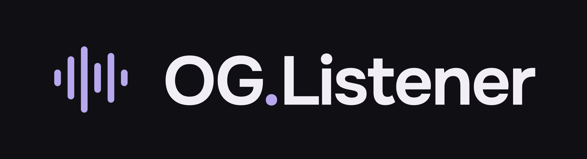

[English](README.en.md)

OG.Listener превращает историю прослушиваний Spotify в личную музыкальную библиотеку. Исследуйте любимые треки и исполнителей, находите первые прослушивания и смотрите, как менялись ваши музыкальные привычки.

[Открыть OG.Listener](https://volner.github.io/OG.Listener/#/upload)

## Возможности

- **Карта прослушиваний.** Чем чаще вы слушали трек или исполнителя, тем крупнее его обложка.
- **Ранние открытия.** Узнайте, кого вы начали слушать до заметного роста аудитории. Сравнение доступно, когда найдены исторические данные.
- **Личная статистика.** Топ-3, количество прослушиваний, время с музыкой и графики по всей библиотеке, отдельному треку или исполнителю.
- **Поиск и фильтры.** Ищите без учёта регистра и пунктуации, выбирайте жанр, период, количество и длительность прослушиваний.
- **Музыка во время просмотра.** Встроенный плеер продолжает играть после закрытия карточки.
- **Русский и английский.** Язык определяется по настройкам браузера, его можно переключить вручную.

Жанры, аудио и история аудитории зависят от доступности внешних источников. Для некоторых песен доступны только превью, а исторические значения слушателей есть не у всех исполнителей.

## Как начать

1. Запросите официальную историю прослушиваний в [настройках конфиденциальности Spotify](https://www.spotify.com/account/privacy/).
2. [Откройте сайт](https://volner.github.io/OG.Listener/#/upload) и загрузите полученный ZIP или JSON.
3. Переключайтесь между треками и исполнителями, открывайте карточки и исследуйте свою историю.

Для использования нужны только браузер и собственный архив Spotify. Статистика строится по всему загруженному архиву, включая прослушивания до первого посещения сайта.

## Ваша библиотека

Архив обрабатывается в браузере и не загружается на сервер. Ваша библиотека сохраняется в том же профиле браузера между посещениями. На другом устройстве или после очистки данных браузера архив потребуется загрузить заново.

Чтобы обновить статистику, используйте кнопку «Загрузить архив». Новый архив заменяет текущую библиотеку.

## Документация

[Техническая документация](docs/README.md) содержит инструкции по локальному запуску и развёртыванию, описание API, источников музыкальных данных и хранения истории.
